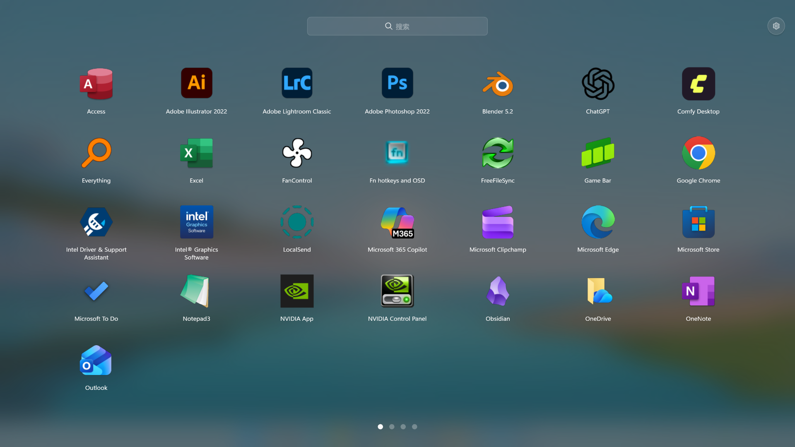
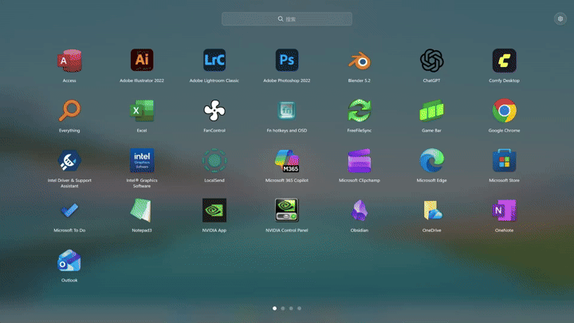
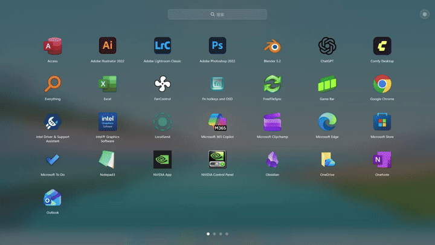
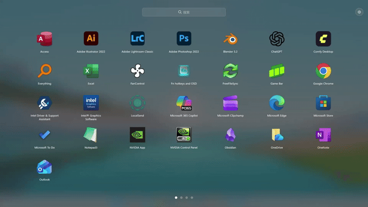
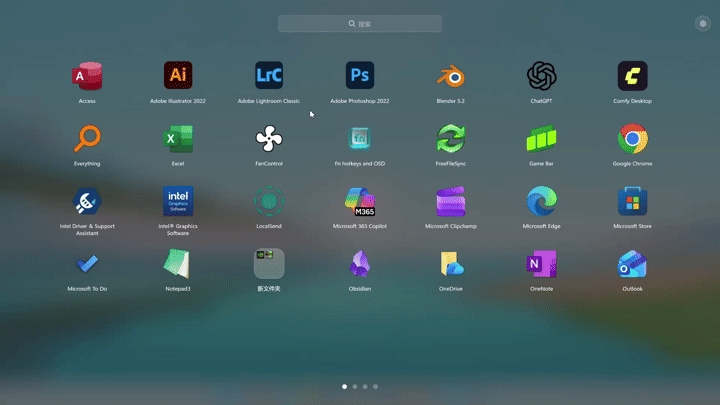

<p align="center">
  <picture>
    <source media="(prefers-color-scheme: dark)" srcset="src/assets/branding/lumeria-app-icon-dark.svg">
    
  </picture>
</p>

<h1 align="center">Lumeria</h1>

<p align="center">Windows 上的应用启动台，支持拼音搜索和文件夹整理。</p>

<p align="center">
  
  <a href="https://github.com/MmMmM2333/Lumeria/releases/latest"></a>
  <a href="LICENSE"></a>
</p>

<p align="center">
  <a href="#安装">安装</a> · <a href="#常用按键">常用按键</a> · <a href="https://github.com/MmMmM2333/Lumeria/issues">反馈问题</a>
</p>
<div align=center></div>

## 功能

- 按名称、拼音或首字母搜索应用。
- 拖动排序，拖到另一个图标上建文件夹，也可以多选后批量整理。
- 用快捷键或屏幕角落（触发角）呼出，支持多显示器。
- 给应用改名、换图标、加启动参数，或设为以管理员身份运行。
- 全屏或窗口显示，背景、行列数、图标大小和深浅色主题都能调。

| 拼音搜索 | 首字母搜索 |
| :---: | :---: |
|  |  |
| **拖拽建文件夹** | **批量管理建文件夹** |
|  |  |

## 安装

从 [Releases](https://github.com/MmMmM2333/Lumeria/releases/latest) 下载 `Lumeria-<版本>-x64-Setup.exe` 直接运行，不需要管理员权限。适用于 Windows 11 x64。

## 常用按键

| 按键 | 作用 |
| --- | --- |
| `Alt+Space` | 呼出或隐藏启动台 |
| 直接打字 | 搜索 |
| 方向键 | 选择应用 |
| `Enter` | 打开选中的应用 |
| `Ctrl+←` / `Ctrl+→` | 翻页 |
| `Esc` | 关闭文件夹、清空搜索或隐藏启动台 |
| 按住 `Alt` | 显示移除和换图标按钮 |

`Alt+Space` 被其他工具占用时（比如 PowerToys Run），可以在「设置 → 通用」里换一个。

## 从源码构建

界面用 PixiJS 和 WebGPU 渲染，运行在 Electrobun 上。数据服务、触发角等系统功能用 Rust 编写。

需要 Node.js 26、Rust（MSVC 工具链）、Visual Studio C++ Build Tools（含 Windows SDK）和 Zig 0.16.0。首次准备还需要 Bun 1.4、CMake 和 PowerShell 7，制作安装包需要 NSIS 3.11。具体版本见[工具链说明](docs/native-toolchain.md)。

```powershell
git clone https://github.com/MmMmM2333/Lumeria.git
cd Lumeria
npm ci
npm run native:prepare:source
npm run native:dev
```

`native:prepare:source` 会下载固定版本的 Electrobun 源码，打上补丁后编译成本地 SDK。只在第一次需要，耗时较长。

制作安装包：

```powershell
npm run native:release
```

安装包输出到 `artifacts/Lumeria-<版本>-x64-Setup.exe`。更多选项见 [Windows 构建说明](docs/windows-release.md)，其他开发文档见 [docs](docs/README.md)。

## 许可证

代码以 [GPL-3.0-only](LICENSE) 发布，说明见 [LICENSING.md](LICENSING.md)。第三方组件保留各自的许可，见 [THIRD_PARTY_NOTICES.txt](THIRD_PARTY_NOTICES.txt)。

Lumeria 的名称和图标不在 GPL 授权范围内。分发修改版时请换用自己的名称和图标，见 [TRADEMARKS.md](TRADEMARKS.md)。
